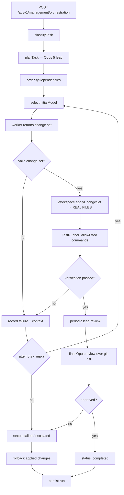

# Orchestration — Hierarchical Planner / Model Router

> **DEvOS.** This orchestration layer is the core of DEvOS, the autonomous
> developer-agent product built on OmniRoute. See [`DEVOS.md`](../../DEVOS.md)
> for the product-level overview, security model, and API reference.

Turns a single coding task into: **lead-model plan → complexity-routed
subtask execution → retry/escalation → periodic lead review → result**.
Built on top of OmniRoute's existing routing stack, not a replacement for it.

## 0. Autonomous execution (the real loop)

`POST /api/v1/management/orchestration` runs the **autonomous** path by default
(`dryRun: true` opts back into plan-only). Entry point:
`runAutonomousOrchestration()` in `src/lib/orchestration/autonomousRun.ts`.



Supporting modules (all under `src/lib/orchestration/`):

| Module             | Responsibility                                                    |
| ------------------ | ----------------------------------------------------------------- |
| `workspace.ts`     | Only filesystem writer. Path/extension/size validation, rollback. |
| `changeSet.ts`     | Parses + validates the worker's structured JSON output.           |
| `codingWorker.ts`  | Wraps a `ModelCaller` so output is applied, not just returned.    |
| `testRunner.ts`    | Allowlisted commands, fixed argv, `shell: false`, timeouts.       |
| `gitInspect.ts`    | Read-only `status` / `diff` / `diff --stat`.                      |
| `autonomousRun.ts` | Assembles the above and runs the final diff-based review.         |

**Fail-closed invariant:** if no `TestRunner` is supplied (or
`verifyCommands` is empty), the subtask is recorded as **failed** with
"could not be verified". Unverified work is never reported as success. This is
locked by a regression test in `tests/unit/orchestration-executor.test.ts`.

## 1. Architecture

```
POST /api/v1/management/orchestration {task}
        │
        ▼
runOrchestration()  (src/lib/orchestration/service.ts)
        │
        ├─ classifyTask()        src/domain/orchestration/taskClassifier.ts
        │
        ├─ planTask()            src/domain/orchestration/planner.ts
        │     → calls the lead model (default: claude-opus-5) for a JSON plan
        │     → falls back to a single-subtask rule-based plan on failure
        │
        ├─ for each subtask (dependency order):
        │     runSubtask()       src/domain/orchestration/executor.ts
        │        → selectInitialModel() / selectEscalatedModel() (router.ts)
        │        → same model → strong worker → lead model, up to
        │          policy.maxAttemptsPerSubtask
        │
        ├─ every N passed subtasks: reviewCompletedSubtasks()  review.ts
        │
        └─ persist OrchestrationRunState after every step
              src/lib/db/orchestrationRuns.ts (SQLite, migration 164)
```

All modules under `src/domain/orchestration/` are **pure** — no DB, no
network. Every side effect (model calls, persistence) is injected by the
caller (`src/lib/orchestration/service.ts`), mirroring the existing
`src/domain/pipeline.ts` convention.

Model calls go through OmniRoute's own `/v1/chat/completions` endpoint
(`src/lib/orchestration/modelCaller.ts`) — orchestration is just another
OpenAI-compatible client of itself, so every existing auth/quota/circuit
breaker/fallback rule still applies to internal calls.

## 2. Model capability registry

`src/domain/orchestration/modelRegistry.ts` holds hand-maintained routing
heuristics (`reasoning`/`coding`/`latency`/`cost`/`reliability`: very-low →
very-high) for the models named in the orchestration brief:

| Model              | Role(s)                    | Notes                                                              |
| ------------------ | -------------------------- | ------------------------------------------------------------------ |
| `claude-opus-5`    | lead, planner, reviewer    | Bedrock: `bedrock/global.anthropic.claude-opus-5`                  |
| `claude-sonnet-5`  | worker (primary), reviewer | Bedrock: `bedrock/global.anthropic.claude-sonnet-5`                |
| `claude-haiku-4-5` | worker (fast), fallback    | Bedrock: `bedrock/global.anthropic.claude-haiku-4-5-20251001-v1:0` |
| `gpt-5.6-luna`     | worker (fallback)          | Requires correct inference profile                                 |
| `auto/minimax`     | worker (fallback)          | MiniMax fallback                                                   |

These ratings are **routing heuristics, not benchmarks**. Add/override via
`registerModelCapability()` at runtime, or extend the array in
`modelRegistry.ts`.

## 3. Task classification

`classifyTask(text, config?)` in `taskClassifier.ts` returns a
`TaskComplexity` (`trivial|simple|moderate|complex|critical`) plus
file-count estimate, architecture-impact flag, risk score, and
reasoning/testing/repo-exploration/human-confirmation flags. Security-
sensitive keywords (auth, credentials, migrations, etc.) always win
`critical`, regardless of other signals — see the module's docstring.
Extend keyword lists via the `config` parameter without editing the file.

## 4. Routing policy

`src/domain/orchestration/router.ts` exports `DEFAULT_ROUTING_POLICY` and
the pure selection functions:

- `selectInitialModel(complexity, policy)` — cheapest/fastest model that is
  "good enough" for the tier (never defaults to Opus for everything).
- `selectEscalatedModel(subtask, attempts, policy)` — walks
  `policy.escalationLadder`; returns `null` once
  `policy.maxAttemptsPerSubtask` is exhausted (never retries forever).
- `shouldTriggerLeadReview(completedCount, policy)` — review every
  `policy.reviewEveryNSubtasks` passed subtasks, not every one.

Persisted, dashboard/API-configurable override lives in
`src/lib/db/orchestrationConfig.ts` (`getRoutingPolicy`/`setRoutingPolicy`/
`resetRoutingPolicy`, `key_value` table, namespace `orchestration`).

## 5. Running it

```bash
curl -X POST http://localhost:20128/api/v1/management/orchestration \
  -H "Authorization: Bearer <your-omniroute-api-key>" \
  -H "Content-Type: application/json" \
  -d '{"task": "Add an endpoint that exports usage as CSV."}'
```

`GET /api/v1/management/orchestration` lists recent runs;
`GET /api/v1/management/orchestration/[id]` inspects one run's plan,
subtask statuses, model choices, attempts, and review notes.

## 6. Adding a new model

1. Add an entry to `DEFAULT_MODEL_CAPABILITIES` in `modelRegistry.ts` (or
   call `registerModelCapability()` at startup).
2. If it should be a worker/lead by default, add its id to
   `DEFAULT_ROUTING_POLICY.fastWorkers` / `strongWorkers` / `leadModel` in
   `router.ts`, or set it via `setRoutingPolicy()`.
3. No other orchestration code needs to change — the router/planner/executor
   only ever see model id strings.

## 7. Changing routing policy

Use `setRoutingPolicy({...})` (persists to SQLite) or extend the
dashboard's Orchestration page to expose the fields you need. Supported
fields: `fastWorkers`, `strongWorkers`, `leadModel`, `fallbackModel`,
`maxAttemptsPerSubtask`, `escalationLadder`, `preferCost`, `preferLatency`,
`reviewEveryNSubtasks`.

## 8. Testing

Pure domain logic is unit-tested with `node:test` under
`tests/unit/orchestration-*.test.ts` using fake `ModelCaller`/`TestRunner`
implementations — no real provider calls, no cost. Run:

```bash
node --import tsx/esm --import ./open-sse/utils/setupPolyfill.ts \
  --import ./tests/_setup/isolateDataDir.ts --test tests/unit/orchestration-*.test.ts
```

Real-provider smoke testing: POST a task to the live server with a
configured API key (see §5) — this exercises the actual Bedrock/OpenAI/
MiniMax model calls end-to-end.

## 9. Troubleshooting

- **"Orchestration requires an API key"** — the management endpoint needs a
  bearer API key (not just a dashboard session) so internal model calls
  respect that key's model access/quotas.
- **Plan falls back to `rule-based-fallback`** — the lead model call failed
  or returned unparsable JSON; check the lead model's connection/credentials.
- **A subtask status is `escalated`** — the retry ladder reached the lead
  model and it still failed; check `reviewNotes`/`error` on the run.
- **`no such table: orchestration_runs`** — restart the server so migration
  `164_orchestration_runs.sql` runs (`src/lib/db/migrationRunner.ts`).
